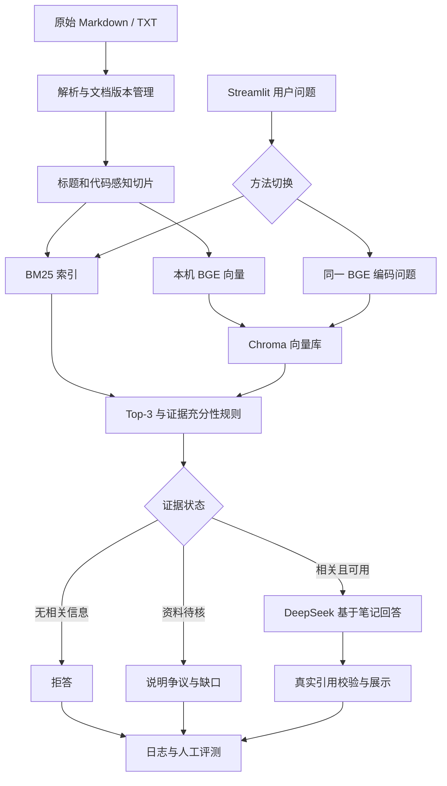

# C++ 个人笔记问答助手：完整项目方案

日期：2026-10-19（Asia/Shanghai）。状态：已建立公共仓库与本地 Git 连接，完成问答、页面、双检索和评测代码；运行验证持续记录于 `docs/implementation-review.md`。正式金标准及人工评分尚未审核，未宣告正式实验完成。

需求依据为 `作业要求/作业要求.png`。截图标明 10 月 21 日截止，具体时刻以课程平台为准；被遮挡文字不推测为额外要求。

## 1. 目标、范围与已确认决策

在本机运行一个 C++ 学习笔记问答助手：中文提问，从本人笔记的文字和代码中找证据，生成带出处的回答，无依据时拒答。只用当前资料，不自动补充教材、外部知识或原创内容。

两种检索是 **BM25 关键词检索** 与 **embedding + 向量库的向量检索**。它们分别放入同一 RAG 流程中比较。RAG 是检索证据后生成回答的整体流程；本机 embedding 计算向量，Chroma 保存及检索向量，DeepSeek 根据检索证据组织回答。

| 事项 | 用户决定 |
|---|---|
| 语料 | 当前 9 篇本人原创 C++ Markdown，保留原文件；新增图片作为第一篇的附件 |
| 目标 | 完整达标，重点做好实验、可复现性和现场演示 |
| 导入 | Markdown + TXT，至少两种格式实际验收 |
| 界面 | 本机 Streamlit，运行时切换方法，展示回答、Top-3 和来源 |
| 模型 | DeepSeek API 生成，本机 embedding 检索 |
| 凭证 | 沿用 `secrets/deepseek_api_key.txt`，不展示或提交明文 |
| 预算 | 调试、重试、正式实验、复测、演示总计不超过 20 元人民币 |
| 证据不足 | 只答有依据部分，明确缺口，不推断完整结论 |
| 评测分工 | AI 起草金标准与规则，用户审核并最终核对判分 |
| 实验量 | 首轮 20 题 × 2 方法，共 40 条正式结果；有余量再复测 |
| 人工时间 | 3–4 小时，优先资料疑点、金标准审核、判分和录屏 |
| 本轮范围 | 建立公共仓库并实施已确认方案；收费开发验证与未批准的正式实验分开 |

首版不做公网部署、模型训练、联网搜索、混合检索、重排序或代码执行服务。计数、解析、切片、检索和引用校验用确定性程序，模型只承担证据回答。

## 2. 现有素材与验收关口

资料共 **9 篇、774 行、25 个 fenced 代码块**。清单和原件哈希见 `data/corpus_inventory.json`，可用 `python scripts/audit_materials.py` 重现。

| 编号 | 原始文件 | 主题 | 保守正文汉字 |
|---|---|---|---:|
| F1 | `1运作原理 编译链接.md` | 编译、预处理、链接、声明与定义 | 486 |
| F2 | `2变量 头文件 调试 条件.md` | 类型、头文件保护、调试与分支 | 416 |
| F3 | `3指针 引用.md` | 指针、引用、裸数组与资源管理 | 449 |
| F4 | `4类和结构体 static ODR.md` | 默认权限、static、ODR、inline | 776 |
| F5 | `5单例模式和局部静态.md` | 单例、静态成员、局部静态 | 1217 |
| F6 | `6枚举 构造函数 析构函数.md` | 枚举、构造重载、禁用构造与析构 | 395 |
| F7 | `7多态 虚函数 初始化列表 智能指针.md` | 多态、虚析构、智能指针、初始化列表 | 1458 |
| F8 | `8纯虚函数（接口） 可见性.md` | 抽象类、接口、const、访问控制 | 484 |
| F9 | `9数组 字符串.md` | 数组、退化、容器、字面量与 string | 988 |
| 合计 | 原始文本含代码注释为 7364 汉字 | 保守正文 | **6669** |

保守口径排除 fenced 代码、行内代码、HTML 标签、图片嵌入和 URL，仅统计 U+3400–U+4DBF / U+4E00–U+9FFF 汉字，不能与非空白字符或英文词数混用。

### 原创内容不少于 1500 字

原创性由用户确认，工具只测量文本。F5、F7 原始汉字为 1503、1745，含代码注释；去除代码后的正文分别为 1217、1458。因此不能把全库总数当成某一篇正文超过 1500 字。

可按原顺序机械汇编九篇为一份《C++ 学习笔记合集》，保留章节及原文件行号映射，不自动补写文字。合集是否满足“一份”、代码注释是否计入，应按课程口径确认；当前验收状态为 **待确认**。不以新目录、重复格式或自动说明凑字数。

### 图片与资料审核

第一篇原引用 `Pasted image 20260815200459.png|368` 对应用户新补的 `1图片引用.png`。通过 `data/attachment_map.json` 关联，保留原文和图片文件名；附件已存在，不再作为缺失项。当前文本索引只使用已有文字和代码，不把未经文字化的图片内容当证据。

原文中有平台、版本、代码完整性、绝对化性能等待核问题，详见 `docs/material-review.md`。保留原件，疑点单独登记；未经审核不当作确定技术结论或金标准。代码写在文档里不代表已编译验证。

## 3. 作业要求与验收映射

| 要求 | 验收方式 |
|---|---|
| 本人原创，至少一份不少于 1500 字 | 计数口径、原文件/合集来源、课程要求的明确判定 |
| 至少两种格式 | Markdown、TXT 分别完成导入、检索和引用验收 |
| 切分与双检索运行时切换 | 同一 chunk 集建两套索引，页面和日志反映实际方法 |
| 调用大模型、有出处 | 保存证据输入与原始回答；末尾显示文件名和原文片段 |
| 无相关信息拒答 | 5 道陷阱题与现场实时提问验证 |
| 交互界面 | Streamlit 本机提问、方法切换、证据与耗时展示 |
| 20 题：10 有答案、5 无答案、5 跨片段 | 人工审核的题库、标准答案、出处和必要证据组 |
| 两方法各跑 20 题 | 两份各 20 条完整原始记录的有效 JSON |
| 正确率、幻觉率、Top-3 命中、平均延迟 | 冻结定义和评分规则后计算；人工核对 |
| 两项分析各至少 200 字 | 方法适用性比较、最失败案例与根因 |
| 至少 3 条真实 AI 开发错误 | 建议/代码、问题、发现证据、修正及复验，不编造 |
| 完整仓库与 README | 环境、安装、导入、建库、启动、评测和交付步骤 |
| PDF 报告不超过 4 页 | 架构图、设置、结果与结论、AI 错误和反思 |
| 3–5 分钟真机录屏 | 正常问答、方法切换、证据、现场陷阱题正确拒答 |

## 4. 架构与选型



| 部件 | 选择与理由 | 限制 |
|---|---|---|
| 环境 | Python 3.12，应用单独 `.venv` | 实际依赖锁定在 requirements.lock.txt |
| Markdown | markdown-it-py 块解析和源行映射 | 区分正文、代码、HTML、附件，不全局正则清洗 |
| TXT | UTF-8 / UTF-8-BOM，段落与行号 | 无标题时使用文件名及行范围 |
| BM25 | jieba、C++ 词项补充、rank_bm25 | 在独立开发集验证分词策略 |
| embedding | Sentence Transformers + BAAI/bge-small-zh-v1.5 | 512 维，本机 CPU；代码/英文效果待实测 |
| 向量库 | Chroma PersistentClient、cosine | 显式传入本机文档与问题向量，避免默认模型介入 |
| 生成 | DeepSeek deepseek-flash，非思考模式 | 之前最小调用成功，持续可用性需真实运行判断 |
| 界面 | Streamlit | 本机运行，首版不依赖公网部署 |
| 数据 | JSONL 过程日志 + JSON 原始结果 + CSV 汇总 | 过程日志和汇总不能替代两份原始 JSON |

## 5. 导入、代码保真与切片

1. 冻结原始清单与 SHA-256，保存 UTF-8 原文、块类型、标题路径和原始行号；不自动改动九篇笔记。
2. HTML 样式仅在正文显示层清理，代码中的 `#include <iostream>`、模板括号和字符串原样保留。原文、显示文本、检索副本分别处理并保留映射。
3. 原始资料的疑点使用独立 correction 记录；用户确认的修改才成为生效版本，不把外部知识无标记地写成笔记原文。
4. 同一 Markdown 与其 TXT 转换件共享 canonical_doc_id，只索引一个有效版本。两格式在验收索引分别测试；转换件不算新增原创内容。
5. 若汇编九篇，每段仍能回到原文件与行号；生成的目录和说明不作为知识证据。附件映射只定位实际本地文件，不推断图片内容。
6. 先按文件及标题切分，不跨文件合并；代码声明与必要解释尽量同片段。初始目标约 250–450 中文字符，以实际 embedding tokenizer 检查长度，避免无提示截断。
7. 超长代码按完整类、函数或语句组拆分，记录共享代码块 ID 和上下文关联；不以模型摘要替换原始代码。
8. 必须保留 `const`、`virtual`、`override`、`static`、`inline`、`::`、`[]`、`*`、`&`、`~`、`= 0`、`= delete`。不能把 `ref = b` 与 `ptr = &b`、`const T*` 与 `T* const`、`delete p` 与 `= delete` 清洗成相同内容。
9. BM25 补充识别 std::unique_ptr、std::string、函数/成员名和操作符。大小写或别名规范化仅用于检索副本，不改引用代码；规则在开发集冻结。
10. 两方法共用同一生效片段集。题库在切分后审核，每道跨片段题需要 2–3 个必要证据组，任何单片段不含全部答案，Top-3 容量足够。

## 6. 问答和引用规则

统一接口为 `retrieve(query, method, k=3)`。BM25 与向量分数量纲不同，分别在开发集调低相关阈值并冻结；两组共用充分性、部分回答和拒答规则。返回 Top-3 不代表资料中有答案。

- 只依据本轮证据回答，语料中的教学指令或措辞不改变系统规则。
- 无相关信息固定回答“文档中没有相关信息”，包括模型本身熟悉但笔记未覆盖的知识。
- 部分证据只支持部分回答；缺少关键条件或结论时明确说明，不靠常识补齐。
- 资料有已登记争议时标记待核，不强行给定论。标准版本、平台和工具链前提必须保留，未记录的信息不猜测。
- C++ 代码仅展示，不自动执行；未经实际编译测试不称可运行。
- 模型输出正文、状态、证据 ID；服务端从真实检索内容生成文件名、章节、行号和原文引用。出处匹配只证明引用存在，语义支持仍需人工评测。
- API 超时、余额不足和网络错误独立记录，不能伪装成资料缺失或改用无证据回答兜底。

页面侧栏展示资料范围、索引状态、方法选择；主区提问与回答；证据区显示 Top-3、代码、原文位置、引用与完整耗时。首次模型下载、建库和加载在提问前完成。

## 7. 数据模型

| 对象 | 主要字段 |
|---|---|
| Document | canonical_doc_id、source_file、sha256、format、version、active |
| SourceBlock | source_file、heading_path、line_start、line_end、block_type、raw_text、review_status |
| Chunk | chunk_id、document_version、source_spans、text、code_block_ids、token_count、review_status |
| RetrievedChunk | chunk_id、rank、raw_score、score_type、source_spans、text |
| Correction | 原文位置、问题、建议、批准状态、生效版本 |
| EvalQuestion | id、type、question、reference_answer、rubric、required_evidence_groups、source_refs、reviewed |
| EvalRun | run_id、question_id、method、语料/配置哈希、检索全文、原始回答、状态、引用、latency、usage、error |
| Judgment | 是否完整答对、陷阱硬编、任一证据命中、全部必要证据覆盖、引用支持、reviewer、notes |

必要证据按“组”表示，等价片段可支持同一事实；跨片段题必须覆盖所有必要组，重叠片段不能冒充多组独立证据。

## 8. 20 题设计

完整问题、来源行号及必要证据组见 `docs/evaluation-blueprint.md`，目前为候选而非批准金标准。

| 类别 | 数量 | 题目范围 |
|---|---:|---|
| Q01–Q10 有答案 | 10 | 编译链接、头文件保护、引用/指针赋值、局部 static、C++17 inline static、首次初始化、禁用构造、初始化列表、const 配合、字符串副本 |
| Q11–Q15 无答案 | 5 | enum class 详细比较、std::move 实现、shared_ptr/weak_ptr、精确 SSO 阈值、std::sort 复杂度与策略 |
| Q16–Q20 跨片段 | 5 | 头文件定义与静态数据成员、引用绑定与成员初始化、数组维护与传参退化、两份多态代码的不同输出、默认与显式访问权限 |

陷阱题需全文确认所问细节确实缺失；出现背景术语不代表能回答。跨文件不自动等于跨片段，须对最终切片审计。候选若依赖未核实断言就调整，不用可疑笔记结论评分。正式问题、标准答案、评分表和结果不得导入知识库。

## 9. 对照实验与指标

主实验固定同一语料、切分、Top-3、上下文预算、生成模型、提示词、参数，只更换检索器及其开发集冻结阈值。每方法首轮跑相同 20 题，共 40 条。每题清空历史、关闭答案缓存、预加载索引和 embedding；交错或随机安排方法顺序并记录种子。

用户审核标准答案后冻结，按预先规则核对全部 40 条，可隐藏方法名及打乱顺序。AI 整理不冒充人工判断。后续修复记录新版本，不拼接修复前后结果；可选复测单列、不择优替换主实验，若报告正确率也要审核相应全部输出。

| 指标 | 明确定义 |
|---|---|
| 答案正确率 | 完整答对题数/20，同时给题数和百分比；陷阱正确拒答计对，部分回答不算完整答对 |
| 陷阱幻觉率 | 5 道陷阱中硬编所问答案的题数/5 |
| Top-3 任一命中 | 15 道可回答题中命中至少一个必要证据组的题数/15；陷阱为 N/A |
| 跨片段完整覆盖 | 5 道跨片段题中覆盖全部必要证据组的题数/5 |
| 首次完整回答平均延迟 | 预热后从独立问题提交到完整答案和引用就绪的平均秒数，包含检索、问题向量、API 及引用处理 |
| 补充诊断 | 过度拒答、遗漏版本条件、代码符号错改、引用不支持、API 错误、token/费用 |

安装、下载、建库和首次冷加载另记；TTFT 如测量也另列。异常和重试不能静默丢弃。同题重复运行不是新独立问题，小样本结果不作普遍保证。

每题保存问题、排序/分数/原文、实际发送证据、原始回答、引用、耗时、用量、异常和人工判断。交付 `results_bm25.json`、`results_vector.json`，每份为 20 条完整记录的有效 JSON 数组；JSONL 日志与汇总 CSV 不能替代它们。

## 10. 成本、环境与凭证

本会话此前 DeepSeek 最小测试 HTTP 200、回复 OK，共 10 token，模型列表包含 deepseek-flash / deepseek-v4-pro。实施阶段另完成两轮独立开发检查共24次真实请求；累计费用上界0.0798048元（含历史0.01元预留），结果与初版错误见 `docs/development-validation.md`，不冒充正式20题成绩。模型通过配置管理。

凭证优先环境变量，其次现有 secrets 文件。不得写进报告、日志或示例配置。所有调用含重试和演示纳入 20 元上限，按真实 usage 和当日官方价格核算，确认账户币种，不能把美元单价直接当人民币。每次调用前检查累计及本次最大 token 成本，接近上限优先取消可选复测。

应用依赖已安装并以实际验证后的锁文件复现。记录 Python、依赖、模型版本、原件哈希、切分和题库/提示词版本及种子。embedding 初次下载需要网络、计算在本机；DeepSeek 回答仍需联网。

## 11. 文件设计与组件

当前已存在原件、规划、代码、20题候选和评测工具。下图为组件与交付设计；是否实际运行及输出哪些文件，以 README 和实施审核记录为准，报告、视频和正式结果不预填。

```text
qianyan1/
  .planning/
    project-plan-cpp-rag.md
    experiment-report-outline.md
  问答素材/
    1运作原理 编译链接.md
    1图片引用.png
    2变量 头文件 调试 条件.md
    3指针 引用.md
    4类和结构体 static ODR.md
    5单例模式和局部静态.md
    6枚举 构造函数 析构函数.md
    7多态 虚函数 初始化列表 智能指针.md
    8纯虚函数（接口） 可见性.md
    9数组 字符串.md
  作业要求/
    作业要求.png
  secrets/
    deepseek_api_key.txt
  .gitignore
  .env.example
  README.md
  pyproject.toml
  requirements.lock.txt
  start.ps1
  config/
    default.toml
  data/
    attachment_map.json
    corpus_inventory.json
    manifest.json
    corrections.json
    # 实际 chunks.json 与 manifest.json 存于被忽略的 storage/
    import_samples/
      note_sample.txt
  storage/
    bm25_tokens.json
    chunks.json
    manifest.json
    chroma/
  src/
    cpp_notes_rag/
      __init__.py
      config.py
      schemas.py
      loaders.py
      chunking.py
      tokenization.py
      indexing.py
      retrieval.py
      generation.py
      service.py
      citations.py
      cost_tracker.py
      cli.py
      app.py
  scripts/
    audit_materials.py
    build_indexes.py
    run_eval.py
    summarize_eval.py
  eval/
    dev_questions.json
    questions.json
    scoring_rubric.md
    run_log.jsonl
    results_bm25.json
    results_vector.json
    judgments.csv
    summary.csv
  docs/
    material-review.md
    evaluation-blueprint.md
    ai_error_log.md
    demo_script.md
  tests/
    test_code_preservation.py
    test_document_identity.py
    test_citation_integrity.py
    test_eval_contract.py
  output/
    report.pdf
    demo.mp4
```

Chroma 内部文件由库生成。文档导入/版本、代码切分、双检索、生成/引用/预算、界面和实验脚本分别对应 loaders/indexing/generation/app/eval 组件，复杂度均为低至中，依赖关系在下一节明确。代码保真、同源去重、引用真实性、题型/结果完整性四类测试有实际验收意义，不写仅镜像实现的测试。

## 12. 分阶段计划与结束条件

| 阶段 | 工作与文件 | 依赖 | 结束条件 |
|---|---|---|---|
| 0 资料审核 | audit_materials、inventory、material-review | 原笔记；盘点已完成 | 九篇可复现清单、附件正确关联、字数口径明确；疑点不作已批准金标 |
| 1 环境与导入 | .venv、loaders、chunking、manifest | 阶段0 | MD/TXT 实际可导入并定位原行；同源去重及代码保真通过；无无提示截断 |
| 2 双检索与题库 | indexing、retrieval、tokenization、eval/questions | 阶段1 | 同一片段集建两索引；开发集调参后冻结；10/5/5 金标准获审核；跨片段2–3证据组且无答案泄漏 |
| 3 生成与界面 | generation、citations、cost_tracker、app、cli | 阶段1/2 | 真实演示有答案、拒答、跨片段；引用真实，错误单列，方法切换有效 |
| 4 主实验 | run_eval、judgments、两份结果、summary | 阶段2/3 | 两份 JSON 各20条、40条人工判断、指标/耗时/费用完整，未超预算 |
| 5 交付 | README、报告、错误记录、录屏 | 阶段4 | 独立启动复现；报告≤4页、两段各≥200字、真实错误≥3条；视频3–5分钟含现场拒答 |

依赖图：0 → 1 → 2；阶段1后界面框架和报告模板可并行；2 + 3 → 4 → 5。无公网部署前置条件。

## 13. 日程、风险与交付

| 日期 | 主工作 | 人工投入 |
|---|---|---|
| 10月19日 | 更新文档、审核资料、环境、导入与切分 | 约30–45分钟确认字数口径和重点技术疑点 |
| 10月20日 | 双检索、界面、冻结金标、主实验 | 约45–60分钟审题，45–60分钟核对40条结果 |
| 10月21日提交前 | 报告、复现、录屏与打包 | 约45–60分钟核对和录制 |

人工目标约3–4小时，审核扩大时先取消可选复测，不省略正式判分或虚构数据。

| 风险 | 处理 |
|---|---|
| 单份1500字口径有歧义 | 并列披露计数，合集保留来源，按课程规则确认 |
| 笔记技术疑点/版本前提不明 | 独立审核表，用户确认后启用有效版本，金标准避开争议 |
| 图像未提供文字证据 | 保留附件，只索引现有文字和代码 |
| 清洗或分词破坏C++符号 | 分块解析，代码原样保留，独立开发集验证 |
| 向量对代码/英文不敏感 | 实际问题验证，据实比较，不预设优于BM25 |
| 必要证据超过Top-3或过度拒答 | 出题审计和独立调阈值；完整覆盖与任一命中分开报告 |
| 真实引用不支持结论 | 程序验出处，人工验语义、条件和代码 |
| 首次下载/依赖、网络和小样本 | 提早验证和缓存，记录测量口径与错误，限定结论范围 |

最终交付：可运行代码与 README、20题与金标、两份原始JSON及判断/汇总、四页以内PDF、3–5分钟视频、真实AI开发错误记录。当前候选、待核资料和预期效果不能写成已完成事实。

技术参考：[DeepSeek 接入](https://api-docs.deepseek.com/quick_start/agent_integrations/)、[模型计费](https://api-docs.deepseek.com/quick_start/pricing/)、[BAAI 模型卡](https://huggingface.co/BAAI/bge-small-zh-v1.5)、[Chroma 数据接口](https://docs.trychroma.com/docs/collections/add-data)、[markdown-it-py](https://github.com/executablebooks/markdown-it-py)。组件在本语料上的实际效果与版本兼容性仍需实施验证。
