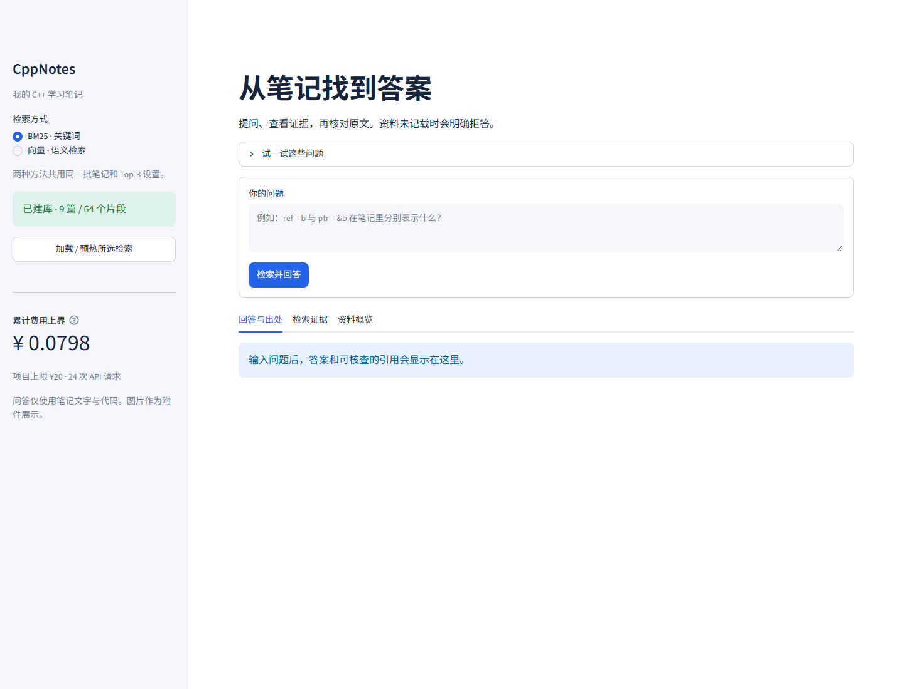

# CppNotes · 个人 C++ 笔记问答

从本人原创笔记中检索证据，由 DeepSeek 生成带原文引用的中文回答。Streamlit 可切换 **BM25 关键词检索** 与 **本机 BGE + Chroma 向量检索**。两者都用于同一个 RAG 流程。

公共仓库：[kibooooku/cpp-notes-rag-lab](https://github.com/kibooooku/cpp-notes-rag-lab)。本项目用于课程实验，完整设计见 [项目方案](.planning/project-plan-cpp-rag.md)，报告安排见 [四页报告结构](.planning/experiment-report-outline.md)。



## 当前进度

已实现 Markdown / TXT 导入、代码与原行映射、统一切片、双检索、DeepSeek JSON 回答、程序提取并校验原文引用、累计预算账本、Streamlit 与 CLI、评测与人工判分工具。实测为 9 篇、64 片段、60 项自动测试通过；修复后 12 条真实开发结果无系统错误，未当作全部答对。详见 [开发验证记录](docs/development-validation.md) 和 [实施审核](docs/implementation-review.md)。

正式 20 题是 **待用户审核的候选金标准**，尚未产出正式 40 条结果或成绩；报告 PDF 和真机视频需在实验与人工核对完成后制作。未把开发检查当正式实验。

## 本机启动

已安装本项目环境时，在 PowerShell 运行：

```powershell
cd D:\xjtu_project\qianyan1
.\start.ps1
```

打开 [http://127.0.0.1:8501](http://127.0.0.1:8501)，选择检索方式，先预热，再提问。答案下面显示文件、章节、原文行号和逐字引文；“检索证据”展示实际 Top-3。修改笔记或导入新文件后，先重新建库。

## 从新克隆安装

需要 Windows / Linux / macOS、Python **3.12**、可联网访问模型下载站与 DeepSeek。当前开发环境使用 CPU，本机无需运行大语言模型。首次安装与模型下载可能花几分钟；下载后向量计算在本机执行，生成回答仍需联网。

```powershell
git clone https://github.com/kibooooku/cpp-notes-rag-lab.git
cd cpp-notes-rag-lab
python -m venv .venv
.venv/Scripts/python.exe -m pip install -r requirements.lock.txt
.venv/Scripts/python.exe -m pip install -e . --no-deps
```

以上为 PowerShell 路径；其他系统将 `.venv/Scripts/python.exe` 换成 `.venv/bin/python`。锁文件记录实测环境的完整版本；如平台没有对应 wheel，应单独建环境验证并保存新锁文件，不能静默混用实验结果。

设置凭证，任选其一：

```powershell
# 方式一：当前终端环境变量
$env:DEEPSEEK_API_KEY = '你的密钥'
# 方式二：把单行密钥保存在 secrets/deepseek_api_key.txt
```

应用不会自动读取 `.env`；`.env.example` 仅说明变量。`secrets/`、`.env`、虚拟环境、模型、索引和运行账本均忽略，不推送到公共仓库。

建库并启动：

```powershell
$env:PYTHONUTF8 = '1'
.venv/Scripts/python.exe scripts/build_indexes.py
.venv/Scripts/python.exe -m streamlit run src/cpp_notes_rag/app.py --server.address 127.0.0.1 --browser.gatherUsageStats false
```

第一次建库从官方模型源下载 `BAAI/bge-small-zh-v1.5`。两种方法使用这次建库的完全相同片段，Chroma 显式使用本机向量，不另行下载默认 embedding。索引与模型版本写在 `storage/manifest.json`。只验证关键词路径可用 `--bm25-only`；这会建立仅 BM25 的索引，使用向量前须重新完整建库。

## 不打开页面的用法

```powershell
# 仅检索：不收费
.venv/Scripts/python.exe -m cpp_notes_rag.cli retrieve '引用 ref = b 表示什么？' --method bm25
.venv/Scripts/python.exe -m cpp_notes_rag.cli retrieve '对象离开作用域如何释放？' --method vector

# 独立问答：会调用 DeepSeek
.venv/Scripts/python.exe -m cpp_notes_rag.cli ask '笔记中头文件保护如何写？' --method bm25
.venv/Scripts/python.exe -m cpp_notes_rag.cli status
```

无依据回答固定为“文档中没有相关信息”。部分有据只回答受支持部分并说明缺口。API 故障和无资料分开显示。检索到原文不等于原文技术结论已核验，待核项会保留标记，详情见 [资料审查](docs/material-review.md)。

## Markdown 与 TXT 的实际验收

```powershell
.venv/Scripts/python.exe scripts/validate_formats.py
.venv/Scripts/python.exe scripts/audit_materials.py
```

格式验收会从第 3 篇导出真实 UTF-8 TXT，在独立临时索引中执行 TXT 导入、BM25 检索和逐字引用验证；结果保存在 `data/import_samples/validation.json`。TXT 与同 stem、同内容 Markdown 共享文档身份，优先索引 MD；任意改名的文件不会被猜测为同源。主知识库只扫描 `问答素材/`，不会读取评测答案或项目说明。

九篇原件及第一篇图片保持原样。图片别名保存在 `data/attachment_map.json`；可在页面查看附件，图像语义未纳入文本检索。单份 1500 字的作业口径仍需确认，不能用重复导入的 TXT 增加原创字数。

## 评测流程

正式集为 `eval/questions.json`：10 有答案、5 无答案、5 跨片段，全部初始 `reviewed=false`。先阅读 [20 题审核单](eval/review-sheet.md)，使用 [判分指南](docs/scoring-guide.md) 核对标准答案与必要证据。脚本不会替用户批准。

```powershell
# 独立开发集：两方法共 12 条，用于调试，不报正式成绩
.venv/Scripts/python.exe scripts/run_eval.py --dev --output eval/runs/dev-01

# 生成当前切片与候选题的证据映射，不批准、不调用 API
.venv/Scripts/python.exe scripts/review_eval.py

# 全部金标准和证据经用户审核并冻结后，运行正式 40 条
.venv/Scripts/python.exe scripts/run_eval.py --output eval/runs/formal-01

# 人工填写对应 judgments.csv 后生成汇总
.venv/Scripts/python.exe scripts/summarize_eval.py eval/runs/formal-01
```

输出包括两份有效 JSON 数组 `results_bm25.json` / `results_vector.json`、完整日志、语料/配置/提示词/题库指纹、耗时、原始输出、用量和空白人工判分表。每次用新目录，异常不丢弃，不自动重试。正式集未审核时脚本会在 API 调用前停止。

指标为答对数 /20、陷阱硬编数 /5、Top-3 任一必要证据命中 /15、跨片段完整覆盖 /5、预热后的完整回答平均耗时。自动来源区间重叠仅是人工核对候选；正确率、幻觉率和引用支持均须人工判分，未审完的正式分母不填百分比。

`eval/runs/` 默认忽略以免误发布开发输出；审核后的正式 JSON/判分/汇总须选择性复制到 `eval/` 作为最终交付，保留原 run 元数据，不挑选最好结果。

## 费用与复现

所有调试、正式实验、重试和演示共享 **20 元人民币** 上限。每次请求先按最大用量预留，收到 usage 后用官方人民币高峰价计算上界，超时或未知用量继续占用预留。`storage/cost_ledger.json` 是跨进程锁定的持久账本，损坏会停止调用，**不要删除账本来重新计算预算**。

计费依据：[DeepSeek 人民币价格](https://api-docs.deepseek.com/zh-cn/quick_start/pricing/)，2026-10-19 核查；当前 Flash 按百万 token 输入未命中 2 元、命中 0.04 元、输出 8 元的高峰价保守记账。界面显示上界，不声称是实际扣费。历史最小可用性测试仅 10 token，另留 0.01 元历史额度。当前只允许已核价的 `deepseek-flash`。

配置在 `config/default.toml`。正式实验前固定模型 revision、切片、阈值、提示词、Top-3 和题库；开发集调试与正式结果分开。模型下载、索引构建、首次加载的冷耗时单列。

## 检查与交付

```powershell
.venv/Scripts/python.exe -m pytest -q --basetemp .cache/pytest
.venv/Scripts/python.exe -m ruff check src scripts tests
python scripts/check_publication.py
```

测试默认不下载模型、不调用收费 API，覆盖代码保真、同源身份、过期索引、双检索接口、非法引用、服务异常、账本损坏、并发预算、评测审核门槛和页面切换。Streamlit 测试/服务需要操作系统允许本机回环连接；限制回环连接的沙盒应在正常本机终端验证。

后续交付包括真实 40 条及人工评分、≤4 页报告、3–5 分钟视频。开发错误记录见 [ai_error_log.md](docs/ai_error_log.md)，录屏步骤见 [demo_script.md](docs/demo_script.md)。
